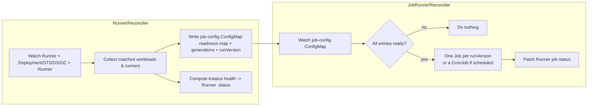

# CLAUDE.md — Hestia Operator

Repo-specific working agreement. Read this and the governing docs before editing.
My global `~/.claude/CLAUDE.md` still applies; this file adds the specifics and
**wins on conflict**.

## What this is

Hestia is a Kubernetes operator that runs a verification **Job** whenever the
workloads it watches roll out, scale, or otherwise settle into a *ready* state —
and reports the verdict as a Kubernetes-native health status. The canonical use
is "auto-run E2E/smoke tests every time my app is deployed and actually healthy,
no matter who triggered the change." See [docs/](docs/) for the full story.

- **Kind:** `Runner` (`e2e.stakater.com/v1alpha1`), namespaced.
- **Scaffolding:** Kubebuilder v4 (`PROJECT`), controller-runtime, Operator SDK
  (OLM bundle + catalog).
- **Language:** Go. Image published to `ghcr.io/stakater/hestia-operator`.

## Architecture (two controllers + a ConfigMap handshake)

The design deliberately splits "decide whether to run" from "run the job". The
job-config **ConfigMap** (named after the Runner) is the handshake between them.

- [internal/controller/runner_controller.go](internal/controller/runner_controller.go)
  — `RunnerReconciler`. Watches the `Runner` plus Deployment/StatefulSet/DaemonSet/
  DeploymentConfig (with `readyPredicateFn`) and other Runners (for chaining).
  Collects matched workloads (`workloadSelector`) and runners (`runnerSelector`),
  writes the job-config ConfigMap, and computes kstatus health.
- [internal/controller/job_runner_controller.go](internal/controller/job_runner_controller.go)
  — `JobRunnerReconciler`. Watches the job-config ConfigMap; **gates on readiness**
  (returns early if any ConfigMap value is `"false"`); creates a `Job` (immediate)
  or `CronJob` (when `spec.schedule` is set), one Job per `runVersion`.

### The rerun mechanism (the subtle part — don't "simplify" it blindly)

- [internal/resources/job_config.go](internal/resources/job_config.go) builds the
  ConfigMap data: a readiness entry per workload (`"true"`/`"false"`), a
  `<key>.generation` entry for rollout kinds, `workloadMinimum` /
  `runnersCountMinimum`, the Runner `generation`, `schedule`, `deadline`, and
  `runVersion`.
- `runVersion` bumps **only when some other entry changed** (`nextRunVersion` /
  `runChanged`). Rewriting the ConfigMap with identical content does **not** rerun
  the job. A job runs **once per `runVersion`**
  ([job.go](internal/resources/job.go) keys the Job on the `runner.stakater.com/version`
  label).
- Consequence (all verified in code and covered by tests): a rollout bumps the
  workload generation → `runVersion++` → new Job. Scaling flips readiness and/or
  generation → rerun. A crash **without** a rollout reruns only if the operator
  observes the workload go not-ready. An operator restart does not rerun.
- If you change trigger semantics, update
  [internal/controller/rollout_trigger_test.go](internal/controller/rollout_trigger_test.go),
  [stable_state_timeout_test.go](internal/controller/stable_state_timeout_test.go),
  and the "When a job runs" section of [README.md](README.md) **together**.

### Readiness & health

- [internal/status/is_ready.go](internal/status/is_ready.go) — per-kind readiness,
  compared against `spec.replicas`. A `Runner` is "ready" when its last
  `JobCompleted` condition reason is `Successful` (this is what makes chaining
  work). `Job` is a supported readiness input too.
- [internal/status/runner_health.go](internal/status/runner_health.go) — derives
  the kstatus `Ready` / `Reconciling` / `Stalled` conditions and the
  `stableStateTimeout` behaviour. The truth table lives in [README.md](README.md#stable-state-timeout).

### Labels ([internal/constants/labels.go](internal/constants/labels.go))

| Label | Set on | Meaning |
|---|---|---|
| `runner.stakater.com/enable: "true"` | the **target workload** | required for Hestia to watch it |
| `runner.stakater.com/name` | job-config ConfigMap / Job | owning Runner |
| `runner.stakater.com/namespace` | job-config ConfigMap / Job | owning Runner namespace |
| `runner.stakater.com/version` | Job | the `runVersion` the Job ran for |

## Layout

- `api/v1alpha1/` — CRD types (`runner_types.go`), conditions, deepcopy.
- `internal/controller/` — the two reconcilers + envtest suites.
- `internal/resources/` — job config, Job, scheduled (CronJob), resource collector.
- `internal/status/` — readiness checks + kstatus health.
- `internal/scheduler/` — cron parsing/scheduling.
- `config/` — kustomize (crd, rbac, manager, samples), `argocd/.../Runner/health.lua`.
- `bundle/`, `catalog/` — OLM packaging.
- `test/` — e2e.
- `docs/` — user documentation (getting started, concepts, comparisons).

## Build, test, run (Makefile)

- `make test` — envtest-backed unit/integration tests (runs `manifests generate fmt vet` first).
- `make lint` / `make lint-fix` — golangci-lint (`.golangci.yml`).
- `make run` — run the controller against your current kube-context.
- `make install` / `make deploy IMG=...` — CRDs / operator onto a cluster.
- `make docker-build docker-push IMG=...`, `make bundle`, `make catalog-build` — images & OLM.

## Conventions

- **TDD.** This repo already tests behaviour with envtest + table-driven cases; add
  the failing test first, keep `make test` and `make lint` green before "done".
- Match controller-runtime / kubebuilder idioms already in the tree.
- Trigger semantics are load-bearing and easy to get subtly wrong — change them
  with tests and docs in the same commit, and say *why* (cite the behaviour).
- Don't widen scope silently; `spec.*` additions to `Runner` are API surface —
  they need a CRD regen (`make manifests`) and a docs update.
