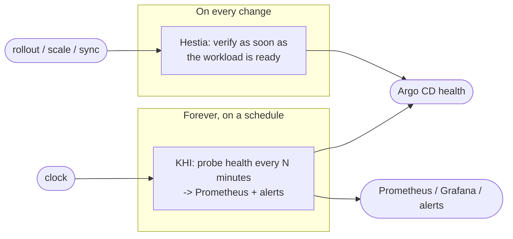

# Hestia vs. kube-health (KHI) — honest guidance

Both Hestia and **kube-health / Kube Health Inspector (KHI)** are Stakater tools
that run a containerised check in your cluster and surface a pass/fail that GitOps
tooling can read. They look similar at a glance and are easy to confuse. They are
**not** the same thing, and in most clusters they **complement** each other rather
than compete.

> This page describes KHI as of its **2.0** split (probe image + runner image). KHI
> is a Helm-chart framework; Hestia is an operator with a CRD.

## The one-line distinction

- **kube-health (KHI)** answers *"is this thing healthy **right now**, checked on a
  schedule?"* — it's **synthetic monitoring**. Trigger = **time**.
- **Hestia** answers *"did this workload pass verification **right after it
  changed** and became ready?"* — it's a **post-deploy verification gate**. Trigger =
  **readiness / rollout**.

Same raw ingredient (run a check, report a verdict); different question, different
trigger, different output.

## Side-by-side

| | **Hestia** | **kube-health (KHI)** |
|---|---|---|
| Form factor | Operator + `Runner` CRD | Helm chart (no CRD, no controller) |
| Trigger | Workload **readiness / rollout / scale**; optional cron | **CronJob** schedule only |
| Core question | "Verify on every change into *ready*" | "Probe health periodically" |
| What runs | Your Job (`spec.template`) | A **probe image** (`doctor.sh` / `result.json`) + shared **runner image** that reports |
| Readiness-aware? | **Yes** — never runs mid-rollout; waits for ready | No — fires on the clock regardless of app state |
| Reacts to out-of-band change (GitOps/HPA/manual)? | **Yes** | No (only when the cron next fires) |
| Primary output | `Runner` status (**kstatus** conditions), Argo CD health via `health.lua` | **ConfigMap** (`status: ok/fail`) + **Prometheus Pushgateway** metrics + Argo CD health via annotations |
| Metrics (Prometheus) | Not built-in (you'd emit from the Job) | **Built-in** (`khi_probe_last_result`, `..._last_run_timestamp_seconds`) |
| Chaining / sequencing | Yes (one level, `runnerSelector`) | No (independent probes) |
| Per-check least-privilege RBAC | You set it on the Runner's pod | **First-class** in `values.yaml` per probe |
| Result contract | Job exit code → conditions | JSON `result.json` (`ok/failed/skipped/error`), "can't run ≠ green" |
| Maturity | `v1alpha1`, early | Charted/packaged, used in SAAP catalog |
| Best at | Release/post-deploy verification, change-triggered | Steady-state synthetic monitoring with metrics & alerting |

## Do they compete or complement?

**Mostly complement.** They sit at two different points in the lifecycle:

- **Hestia** is your *gate at the moment of change*: "the new rollout settled and
  passed its smoke test." It won't tell you the app quietly broke three hours later —
  nothing changed, so Hestia doesn't re-run.
- **KHI** is your *always-on watchman*: "every 30 minutes, prove Postgres still
  accepts writes," with a Prometheus time series you can alert and graph on. It won't
  react immediately to a deployment — it runs when the cron next fires.

Used together: **Hestia verifies the change; KHI watches the steady state.**

### Where they overlap (and you must choose)

Both can "run a container and expose ok/fail to Argo CD." If your need is exactly
*"run `postgres-e2e` every hour, alert on failure, graph the result,"* use **KHI** —
it's lighter (no operator), Prometheus-native, and has per-probe RBAC built in. If
your need is *"run smoke tests the instant this app rolls out, and only when it's
actually ready,"* use **Hestia** — KHI's cron simply can't express that trigger.

## When to use which

**Reach for Hestia when:**

- Verification must run **on deployment/rollout/scale**, not on a timer.
- You must catch changes made **outside your pipeline** (GitOps sync, HPA, manual
  restart).
- You want the verdict as **kstatus** health for `kubectl wait` / Argo CD gating.
- You want to **sequence** checks (`runner-2` after `runner-1`).

**Reach for kube-health (KHI) when:**

- You want **continuous, periodic** probing independent of deployments.
- You need **Prometheus metrics** and alerting on probe results.
- You want strict **per-probe least-privilege RBAC** declared in Helm values.
- You care about the "**a test that can't run must never show green**" semantics
  (KHI's `skipped`/`error` → `failed`, broken test → failed Job, no false green).
- You don't want to run an operator/CRD — just Helm + CronJobs.

**Use both when** you want *change-triggered verification* **and** *steady-state
monitoring* — which is the common production answer.

## The honest "why-first" question for Stakater

Hestia and KHI share a conceptual core: *run a check, map it to a GitOps-readable
verdict.* They differ mainly in **trigger** (event vs. time) and **reporting**
(kstatus vs. ConfigMap+Prometheus). It's worth asking whether that justifies two
separate mechanisms long-term, or whether one framework with pluggable triggers
(event **and** schedule) and pluggable reporters (kstatus **and** Prometheus) would
serve users better. Today they're genuinely different tools for different questions —
but the overlap is real, and the decision of "which do I install?" is a tax on users
until the positioning above is crisp and documented (which is what this page is for).
