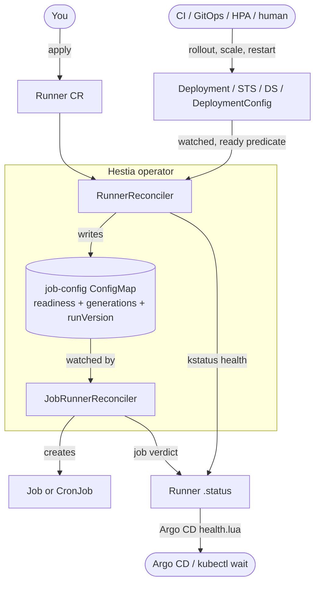
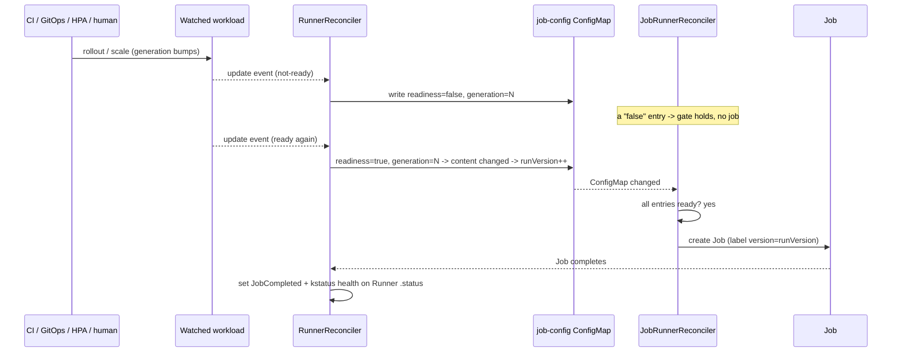
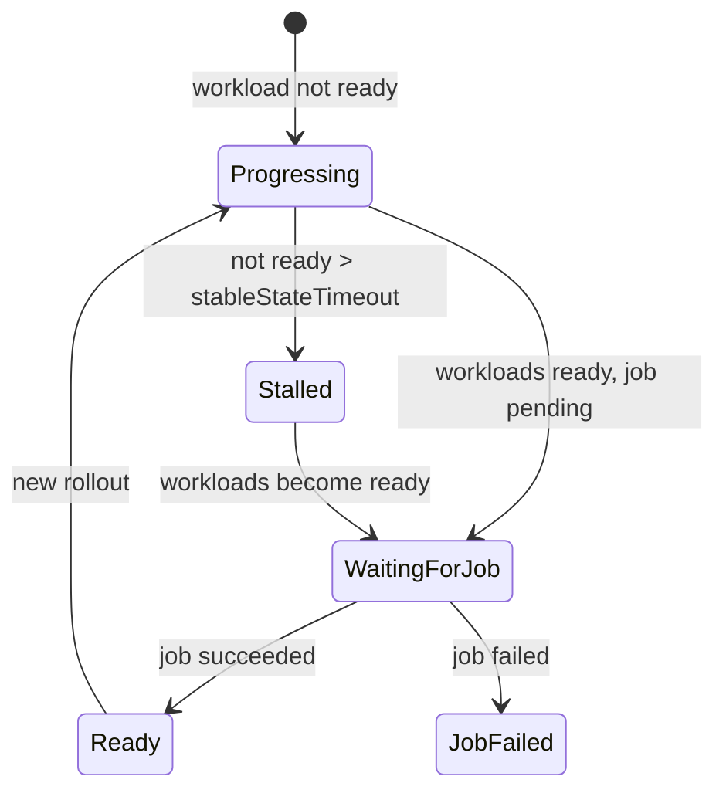

# How Hestia works

This page explains the architecture and — most importantly — the exact rules for
**when a job runs and re-runs**. Everything here is traceable to the controller
code; file references are included so you can verify it yourself.

## Mental model

A `Runner` is a standing instruction:

> "Watch these workloads. Whenever they settle into a **ready** state after a change,
> run this Job once, and report the result as my health."

Hestia is therefore **event-driven and readiness-gated**, not time-driven. The clock
(cron) is optional; the default trigger is *change + readiness*.

## Components

Hestia runs **two cooperating controllers** that communicate through one
**job-config ConfigMap** (named after the Runner). Splitting "decide" from "do"
keeps each loop simple and makes the trigger logic testable.

- **RunnerReconciler** — [internal/controller/runner_controller.go](../internal/controller/runner_controller.go).
  Watches the `Runner`, the four workload kinds (Deployment, StatefulSet, DaemonSet,
  DeploymentConfig) through a readiness predicate, and other Runners (for chaining).
  It collects the matched objects and writes their readiness into the job-config
  ConfigMap. It also computes the Runner's kstatus health.
- **JobRunnerReconciler** — [internal/controller/job_runner_controller.go](../internal/controller/job_runner_controller.go).
  Watches the job-config ConfigMap. It **gates on readiness** and then creates a
  one-shot `Job` (or a `CronJob` if `spec.schedule` is set).

## The job-config ConfigMap (the handshake)

For each Runner, `RunnerReconciler` maintains a ConfigMap
([job_config.go](../internal/resources/job_config.go)) whose data encodes everything
that should decide a run:

| Entry | Example | Meaning |
|---|---|---|
| `<workload-key>` | `"true"` / `"false"` | readiness of each matched workload |
| `<workload-key>.generation` | `"7"` | `.metadata.generation` of a rollout-capable workload |
| `workloadMinimum` | `"true"` | at least one workload matched `workloadSelector` |
| `runnersCountMinimum` | `"true"` | at least one Runner matched `runnerSelector` |
| `generation` | `"3"` | the Runner's own generation |
| `schedule`, `deadline` | `"0 * * * *"`, `"120"` | copied from the spec |
| `runVersion` | `"5"` | **the run identity** — a job runs once per value |

### Readiness gate

`JobRunnerReconciler` scans the ConfigMap and **does nothing if any value is
`"false"`** ([job_runner_controller.go](../internal/controller/job_runner_controller.go)).
So a job is created only when:

- every matched workload is ready, **and**
- at least one workload matched (if `workloadSelector` is set), **and**
- every matched upstream Runner has succeeded (if `runnerSelector` is set).

No job runs while a watched workload is mid-rollout, unhealthy, or the selector
matches nothing.

### Run identity: `runVersion`

`runVersion` bumps **only when some other entry changed** — `nextRunVersion` /
`runChanged` in [job_config.go](../internal/resources/job_config.go). A job runs
**exactly once per `runVersion`**: the Job carries a `runner.stakater.com/version`
label, and [job.go](../internal/resources/job.go) reuses the existing job for the
current version and only creates a new one when the version advances.

This is what makes re-runs precise:

- A **rollout** bumps the workload's `generation`, so `<key>.generation` changes →
  `runVersion++` → a new job runs. This catches even a rollout that finishes so fast
  the workload never looked not-ready.
- Rewriting the ConfigMap with identical content (e.g. an operator resync) leaves
  `runVersion` unchanged → **no** rerun.

## When a job runs

A Runner runs its job once all watched workloads are ready, and **again** after any
of these, once the workloads are ready again:

- a **rollout** of a watched workload (new image, config change, `kubectl rollout
  restart`, `oc rollout latest`) — however quickly it finishes;
- **scaling** a watched workload, including by an autoscaler;
- a workload **starting or stopping to match** the selector;
- a change to the **Runner** itself.

And the edge cases, stated honestly:

- A **pod restart or deletion without a rollout** reruns the job only if it leaves
  the workload not-ready long enough for the operator to observe the transition.
- An **operator restart** does **not** rerun the job (the ConfigMap content is
  unchanged, so `runVersion` holds).
- **No job runs** while any watched workload is not ready, or the selector matches
  nothing.

### Flow of a single rollout → rerun

## Health & kstatus

`RunnerReconciler` summarises the Runner as standard
[kstatus](https://github.com/kubernetes-sigs/cli-utils/tree/master/pkg/kstatus)
conditions (`Ready`, `Reconciling`, `Stalled`) via
[runner_health.go](../internal/status/runner_health.go). This is what lets
`kubectl wait --for=condition=Ready runner/...` and the Argo CD health check work
without custom glue.

The **stable-state timeout** guards against a rollout that never becomes healthy:
if watched workloads stay not-ready longer than `stableStateTimeout` (default
`30m`, `"0s"` disables it), the Runner reports `Stalled=True` with reason
`StableStateTimeout`, naming the stuck workloads. The full truth table is in the
[README](../README.md#stable-state-timeout).

## Readiness, precisely

Readiness is computed per kind in [is_ready.go](../internal/status/is_ready.go),
compared against the workload's **desired** replicas (so a brand-new workload
reporting `0/0` is correctly "not ready yet"):

- **Deployment / StatefulSet** — observed generation caught up **and** replicas,
  updated, and available/ready replicas all equal `spec.replicas`.
- **DaemonSet** — desired scheduled equals ready, available, and updated.
- **DeploymentConfig** (OpenShift) — `Available` condition true and ready ==
  available replicas.
- **Runner** (for chaining) — its last `JobCompleted` condition reason is
  `Successful`.
- **Job** — has a `Complete` condition. (Hestia can treat a Job as a readiness input.)

Kinds the cluster doesn't serve (e.g. `DeploymentConfig` off OpenShift) are skipped
silently rather than erroring.
