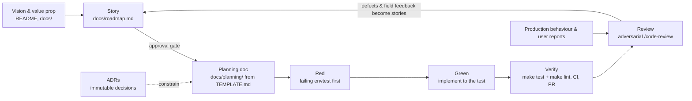

# The Hestia Method — vision → story → plan → red → green → verify → review

How Hestia is built. This is the same customized, BMAD-derived development
strategy we run in our other operator projects (kube-ward, kube-census), adapted
to Hestia's reality. It is **not aspiration**: every practice below is enforced
*somewhere concrete* — a convention, a CI gate, an immutable doc — and the
enforcement column says where. Where a practice is *not yet* mechanically
enforced, this document says so plainly (honesty over completeness), and the gap
is tracked as a story rather than papered over.

The method codifies what the repo already does, so a cold session, a new
teammate, or a future agent doesn't have to re-derive it from git archaeology.

## The loop

Two loops. The **inner build loop** (story → plan → red → green → verify → review)
ships one story end-to-end. The **outer feedback loop** (field behaviour and bug
reports → defect-family stories → fix + regression test → re-review) keeps the
product honest over time. Hestia's outer loop is lighter than kube-ward's — Hestia
is a deterministic operator with no LLM, no advisory corpus, and so no graded eval
harness — but the principle holds: a shipped fix is only "done" when a regression
test pins the behaviour it fixed.

## The practices, and where each is enforced

| Practice | Lineage | What it looks like here | Enforced by |
|---|---|---|---|
| Spec first | spec-driven development | vision → story → planning doc **before code**, in order | this method + review; planning doc committed before implementation |
| Immutable decisions | ADRs (Nygard) | `docs/adr/` — accepted ADRs are never edited, only superseded | ADR convention (below) + review |
| Story-driven delivery | user stories / agile | house format + **Done:** line + lifecycle gate, one story at a time | `docs/roadmap.md`; PR descriptions cite the story |
| Test-first | TDD (Beck) | red → green → refactor through envtest + boundary fakes | `make test` locally; CI runs unit tests on every PR (`.github/workflows/pull_request.yaml`, `ENABLE_UNIT_TESTS`) |
| Green before done | Definition of Done | `make test` **and** `make lint` green, output seen | CI runs lint + unit tests on every PR (`ENABLE_LINTING`, `ENABLE_UNIT_TESTS`) |
| Domain modeling | DDD (Evans) | controller-runtime idioms; readiness/health kept in `internal/status`, triggering in `internal/controller`, resources in `internal/resources` | boundary conventions in [CLAUDE.md](../CLAUDE.md); review |
| Adversarial review | multi-agent verification | `/code-review`: independent finder angles → cross-verified findings → fixes re-reported | the review flow |
| Context persistence | our substitute for persona handoffs | [CLAUDE.md](../CLAUDE.md) invariants + memory + context-capsule planning docs | convention; `docs/planning/TEMPLATE.md` |

**Known enforcement gap (tracked, not hidden):** unlike kube-ward, Hestia has **no
`make verify` target and no PostToolUse hook** — the DoD is enforced at the CI gate,
not on every local edit. Closing that gap is a Draft story in
[docs/roadmap.md](roadmap.md) (DX.1). Until then, "done but unverified locally" is
possible between commits; the PR gate is the backstop.

## Story lifecycle

**📝 Draft** — written down so it isn't lost; explicitly *not* agreed. May be
re-scoped or killed; killing a weak Draft is a success of the method, not a
failure. → **👍 Approved** — a human said build it. The gate exists because
comply-by-default is the failure mode: an unapproved story must never start.
→ **🔨 In progress** — one at a time, end-to-end. → **✅ Done** — the Done line
met, `make test` + `make lint` green, planning doc linked from the story.

## The planning doc is a context capsule

`docs/planning/TEMPLATE.md` is the contract: a planning doc must carry enough
context that a **cold session** — no memory, no conversation history — can execute
the story from that file alone, without re-scouting the codebase. That means the
story and its why, the governing ADRs/invariants, the exact seams and files, the
test list (which tests, at which seams, red first), and the explicit out-of-scope.
If a planning doc needs its author present to be actionable, it isn't done.

> Prior art: [`docs/superpowers/specs/2026-09-30-stable-state-timeout-design.md`](superpowers/specs/2026-09-30-stable-state-timeout-design.md)
> is a design spec written in this spirit before the convention was named. New
> planning docs copy `docs/planning/TEMPLATE.md`.

## Relationship to BMAD

This is BMAD (the spec-driven, multi-agent framework) with deliberate
customizations, the same set we run in kube-ward and kube-census:

- BMAD's brief/PRD ↔ our vision/value-prop docs (README, `docs/`).
- BMAD's Architect phase ↔ our **immutable** ADRs (BMAD's architecture doc is
  mutable; ours are append-only and superseded, never edited).
- BMAD's story files ↔ our **story + planning-doc** pair, with the context-capsule
  discipline (`TEMPLATE.md`) and an explicit **Draft/Approved lifecycle gate**.
- BMAD's QA gate ↔ our CI gate (lint + unit tests) plus multi-angle `/code-review`.

What we deliberately keep our own: **persistent memory + human gates instead of
persona handoffs** (one agent, multi-agent only where fan-out pays — review);
**immutable ADRs**; and an **outer feedback loop** driven by production behaviour
and regression tests rather than personas signing off.

## Invariants of the method itself

1. **No production code without a red test that demanded it.**
2. **No implementation without a committed plan; no plan without a story; no story
   built without approval.**
3. **Honesty over completeness** — "couldn't verify / not assessed" beats a
   confident guess, in status reports and in docs alike. A claimed fix with no
   regression test is a Draft claim.
4. **Docs are the source of truth and move with the code** — a semantic change
   that leaves `docs/` or an ADR stale is an unfinished change.
5. **Decisions are immutable once accepted** — change your mind by superseding an
   ADR, not editing it, so the evolution stays legible.
